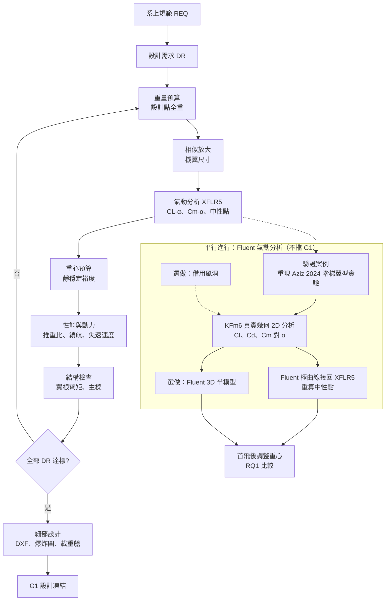
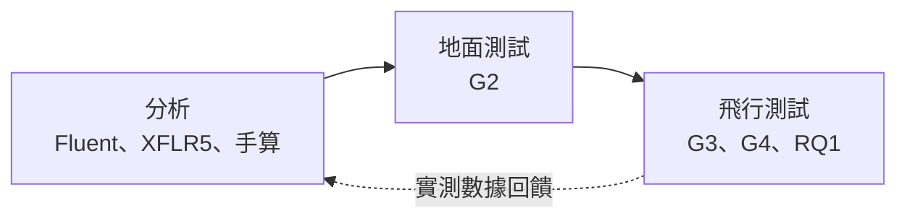

# 計劃書：FOS_UAV 工程基準化——開源固定翼飛翼的系統工程重建與飛行驗證

> 逢甲大學航太專題與實作 第 8 組｜組內執行版｜初稿完成（2026-10-16），待組員審閱
> 構想演進見 [idea-evolution.md](idea-evolution.md)，評估見 [evaluation-report.md](evaluation-report.md)，課程規範見 [../course/README.md](../course/README.md)。

## 摘要

FOS_UAV 是印度 ICFOSS 公開的低成本固定翼飛翼測繪平台，有完整的 CNC 設計檔與製作日誌，但缺少需求定義、重量與重心預算、性能與穩定度分析，也沒有任何試飛數據；最新飛行版本 V4.0 的設計檔甚至遺失。本專題以系統工程流程將 FOS_UAV 重建為一份可重現、可驗證的**工程基準**。我們以已飛過的 V4.0 為基準做**相似放大**，讓翼負載維持在已驗證的約 35 g/dm²，並以**載重狀態**為設計點，將 350 g 載重置於重心正下方，使空機與載重飛行的配平相同。動力系統改用系上提供的 510KV 馬達與 60A 電調，加裝自購的 ArduPilot 飛控與空速計以記錄飛行數據。試飛採**逐步加碼**的四道關卡，本學期的底線是完成空機與載重五邊飛行。此外，我們以 ANSYS Fluent 分析 KFm 階梯翼型的真實幾何，並先用已發表的風洞實驗驗證 CFD 設定，再回答一個文獻中尚未回答的問題：不同預測方法對 KFm 飛翼中性點的預測，與飛行配平實測相差多少？本專題的成果包括一架可飛的載具、一套對應系上報告要求的分析，以及一份讓下一屆能照著重現的設計檔與參數檔。

---

## 1. 背景與問題

### 1.1 FOS_UAV 的現況

| 有的 | 缺的 |
|---|---|
| V0.5–V3.0 的 DXF 設計檔（可直接 CNC 或手工切割） | **V4.0 的設計檔**（README 主推的版本） |
| V1.0–V4.0 的製作日誌與教訓 | 需求定義、重量與重心預算 |
| 零件清單（BOM） | 性能、穩定度、結構分析 |
| 飛行影片 | **任何量化的試飛數據** |
| — | 授權條款（repo 沒有 LICENSE） |

詳見 [FOS_UAV 專案分析](../fos-uav-analysis.md)。

### 1.2 文獻缺口

依 [2026-10-16 文獻調查](../literature-survey/2026-10-16/survey_report.md)：

- **KFm 階梯翼型的結論互相矛盾**，且只有升阻力數據，**沒有俯仰力矩**，也**沒有飛行實測**。對飛翼而言，俯仰力矩決定能否配平與穩定。
- 近年的小型飛翼研究採用「開源工具設計 → 低成本製作 → 飛行驗證」的流程（如 Milenković-Babić 2024、Zięba 2026），但沒有人用這套流程檢驗 KFm 飛翼。
- 低成本飛行測試方法已經成熟（Simmons 2023、Weishäupl 2023），可以直接借用。

### 1.3 問題陳述

> 我們要如何在約 4–6 週內，只用系上提供的零件加上自購飛控，把 FOS_UAV 從一份製作日誌變成一套**有分析、有驗證、可重現**的工程基準，並在本學期完成空機與載重飛行？

---

## 2. 目標與成功標準

### 2.1 目標

| 編號 | 目標 | 優先度 |
|---|---|---|
| O1 | 完成空機五邊飛行 | **底線** |
| O2 | 完成 350 g 載重五邊飛行 | **底線** |
| O3 | 用飛行紀錄驗證巡航速度、續航、配平重心等預測值 | 高 |
| O4 | 回答研究問題 RQ1（中性點的預測 vs 實測） | 中（時程衝突時第一個犧牲） |
| O5 | 交付可重現的設計檔、參數檔與分析（工程基準） | 高 |

### 2.2 研究問題

**RQ1**：以下三種方法預測的 KFm6 飛翼中性點，與飛行配平實測各相差多少（以平均氣動弦長 MAC 的百分比表示）？

1. XFLR5，以階梯外包絡線近似翼型
2. XFLR5，翼型極曲線改用經驗證的 Fluent 2D 結果
3. Fluent 3D 半模型（選做）

### 2.3 四道關卡

每道關卡的出口條件全部達成，才進入下一道。

| 關卡 | 名稱 | 出口條件 |
|---|---|---|
| **G1** | 設計凍結 | 重量重心預算完成；XFLR5 顯示靜穩定裕度在目標範圍內；推重比與續航達標；DXF 定稿；採購到貨 |
| **G2** | 地面測試通過 | 重心實測與預算差 < 5 mm；舵面方向與行程正確；推力實測達預期；失控保護觸發正常；老師完成地面操作說明 |
| **G3** | 空機首飛 | 無動力滑翔確認配平後，有動力起飛、五邊飛行、機腹著陸完成；飛行紀錄完整 |
| **G4** | 載重飛行 | 350 g 載重完成五邊飛行；配平量與空機相近（驗證「載重在重心上」的設計） |

**本學期的時程優先順序**：G3 → G4 → RQ1 試飛。

---

## 3. 需求與需求追溯

### 3.1 從系上規範導出的設計需求

系上規範（REQ）是「要達成什麼」；設計需求（DR）是我們為了達成它，自己定下的具體數字。

| 編號 | 設計需求 | 來源 | 依據 |
|---|---|---|---|
| DR-01 | 設計點全重（含載重）約 1.8 kg，第 1 週以重量預算確認 | REQ-06 | 載重狀態為設計點 |
| DR-02 | 載重重心與全機重心的水平距離 ≤ 5 mm | REQ-06、REQ-09 | 讓空機與載重的配平相同 |
| DR-03 | 翼負載 ≤ 35 g/dm² | REQ-06 | 與 FOS_UAV V4.0 已飛過的數值相同 |
| DR-04 | 翼展 ≤ 1.6 m（預估約 1.47 m） | REQ-02 | 相似放大結果；遠低於 3 m 上限 |
| DR-05 | 靜穩定裕度 5–10% MAC | REQ-09 | 飛翼常用範圍，以 XFLR5 確認 |
| DR-06 | 推重比 ≥ 0.8（載重狀態） | REQ-03、REQ-09 | 台車起飛與爬升需要 |
| DR-07 | 續航 ≥ 8 分鐘，且降落時電池剩 ≥ 30% | REQ-05 | 規範 3–5 分鐘加安全餘裕 |
| DR-08 | 不需手擲：起飛台車或彈射繩起飛，草地機腹著陸 | REQ-03 | 老師無法手擲 |
| DR-09 | 飛控提供 FBWA（增穩）、MANUAL（手動）、RTL（返航）三種模式與失控保護 | REQ-09 | 老師操作安全 |
| DR-10 | 記錄空速、姿態、舵量、電壓電流 | O3、O4 | 驗證與 RQ1 需要 |
| DR-11 | 耗材 ≤ NT$8,000，追加上限 NT$4,000 | REQ-08 | 系上規範與組內預算 |
| DR-12 | 系上提供的馬達、電調、遙控器不改裝 | REQ-04、REQ-08 | 用現有零件 |

### 3.2 驗證方式

| 設計需求 | 分析 | 地面測試 | 飛行測試 |
|---|---|---|---|
| DR-01 全重 | 重量預算 | 秤重 | — |
| DR-02 載重重心 | 重心預算 | 懸吊找重心 | G4 配平比較 |
| DR-03 翼負載 | 計算 | 量面積＋秤重 | — |
| DR-04 翼展 | 設計圖 | 量測 | — |
| DR-05 靜穩定裕度 | Fluent＋XFLR5 | 無動力滑翔 | RQ1 配平試飛 |
| DR-06 推重比 | 原廠推力表 | 推力實測 | 爬升率 |
| DR-07 續航 | 功率估算 | — | 計時＋電池剩餘 |
| DR-08 起降方式 | — | 台車滑跑測試 | G3、G4 |
| DR-09 飛行模式 | — | 模式切換、失控保護測試 | G3 |
| DR-10 數據記錄 | — | 地面錄製檢查 | 每次飛行 |
| DR-11 經費 | 經費表 | — | — |
| DR-12 現有零件 | 檢查 | 檢查 | — |

---

## 4. 設計方法與分析

> 本章的數字都是**初估**，用來說明方法與檢查量級；第 1–2 週會用實際秤重與 XFLR5 結果取代。標示「估」的數值不可直接寫進期末報告。

### 4.1 設計流程

重量是所有分析的起點，也是最常需要回頭修正的量：只要全重變了，機翼尺寸、重心、性能就全部要重算，所以流程是一個迴圈。

**Fluent 分析平行進行，不擋 G1 設計凍結**。載重飛行是本學期底線，首飛不能等 CFD。首飛重心以保守的前重心決定，再用無動力滑翔確認（見 4.4）；Fluent 結果用於首飛後的重心調整、RQ1 與期末報告。

### 4.2 相似放大

**原則**：翼型、後掠角、梯形比、重心佔 MAC 的百分比全部不變，只把平面尺寸乘上同一個倍率 $k$，使翼負載維持在 FOS_UAV V4.0 已飛過的數值。

翼負載不變代表：

$$
\frac{W}{S} = \frac{W_{\text{ref}}}{S_{\text{ref}}}, \quad S = k^2 S_{\text{ref}}
\quad\Rightarrow\quad
k = \sqrt{\frac{W}{W_{\text{ref}}}}
$$

**基準與放大結果（估）**：

| 項目 | V4.0 基準 | 放大後（$W$ = 1.8 kg） |
|---|---|---|
| 全重 $W$ | 1.3 kg | 1.8 kg |
| 倍率 $k$ | 1 | $\sqrt{1.8/1.3} \approx 1.177$ |
| 翼展 $b$ | 1250 mm | ≈ 1471 mm |
| 翼根弦長 $c_r$ | 380 mm | ≈ 447 mm |
| 翼尖弦長 $c_t$ | 220 mm | ≈ 259 mm |
| 後掠角 | 30° | 30°（不變） |
| 機翼面積 $S$（梯形近似，不含中央機身） | ≈ 0.375 m² | ≈ 0.519 m² |
| 翼負載 | ≈ 34.7 g/dm² | ≈ 34.7 g/dm² |
| 平均氣動弦長 MAC | ≈ 0.307 m | ≈ 0.361 m |

MAC 以梯形翼公式計算，$\lambda = c_t / c_r$：

$$
\text{MAC} = \frac{2}{3} c_r \frac{1 + \lambda + \lambda^2}{1 + \lambda}
$$

**相似放大的三個副作用（需要討論）**：

1. **雷諾數變大**：翼負載相同時，同一升力係數下的飛行速度不變，所以雷諾數與弦長成正比，約放大 1.18 倍（見 4.4）。這通常對性能有利。
2. **相對厚度變薄**：KFm6 的每一層厚度由泡棉板決定（5 mm），不會跟著放大。弦長變長、層厚不變，翼型的相對厚度就會變小約 15%。**選項**：維持 5 mm 板（翼型略薄）、改用較厚的板，或在主要區域多疊一層。
3. **結構負荷變大**：翼根彎矩約與 $W \cdot b \propto k^3$ 成正比，放大約 1.63 倍。FOS_UAV 原設計沒有主樑，放大後需要加主樑（見 4.6）。

### 4.3 重量與重心預算

**重心公式**（以機頭為原點，$x$ 向後為正）：

$$
x_{cg} = \frac{\sum_i m_i x_i}{\sum_i m_i}
$$

**靜穩定裕度**：

$$
\text{SM} = \frac{x_{np} - x_{cg}}{\text{MAC}}
$$

其中 $x_{np}$ 是中性點，由 XFLR5 求得。DR-05 要求 SM 介於 5–10%。

**重量預算表（估，待秤重）**：

| 項目 | 估計質量 (g) | 來源 | 位置 $x_i$ |
|---|---|---|---|
| 馬達 ECO 3520C-V2 | 210 | 原廠規格 | 機尾（推進式） |
| 電調 Platinum 60A V4 | 49 | 原廠規格 | 待定 |
| 螺旋槳 15×6E | ≈ 30 | 估 | 機尾 |
| 飛控（F405 固定翼板） | ≈ 25 | 估 | 重心附近 |
| GPS（BN-880） | ≈ 10 | 估 | 待定 |
| 空速計 | ≈ 5 | 估 | 待定 |
| 接收機 R3008SB | ≈ 10 | 估 | 待定 |
| 舵機 ×2 | ≈ 27 | 估 | 機翼 |
| 電池 5S 2200 mAh | ≈ 290 | 估 | **用來調整重心** |
| 線材、接頭 | ≈ 50 | 估 | — |
| **載重** | **350** | REQ-06 | **重心正下方**（DR-02） |
| **機身結構**（泡棉、主樑、膠、膠帶、載重艙） | **≈ 744** | 差額 | — |
| **合計** | **1800** | DR-01 | — |

**合理性檢查**：從 FOS_UAV V4.0 的全重 1.3 kg 扣掉電子設備、電池、GoPro，機身結構約 500 g。面積放大 $k^2 \approx 1.39$ 倍後約 690 g，再加上主樑，與上表的 744 g 同量級。**第 1 週必須秤一片泡棉板**：替代材料的密度是這張表最大的不確定因素。

**推進馬達的重心問題**：系上的馬達比 FOS_UAV 原設計重約 110 g，裝在機尾會讓重心後移。對策是**把電池往前放**，用電池位置來調整重心。重心預算要列出電池的可移動範圍，確認在範圍內能讓 SM 落在 5–10%。

### 4.4 氣動分析（Fluent ＋ XFLR5）

**為什麼要用 Fluent**：XFLR5 的翼型分析器（XFOIL）無法處理階梯造成的分離流與回流區，而這正是 KFm 翼型的關鍵物理現象，也直接影響飛翼賴以配平的俯仰力矩。只用「外包絡線」近似的誤差不可接受，因此改以 ANSYS Fluent 分析 KFm6 的真實階梯幾何。

**Fluent 本身也有誤差**：本專題的雷諾數約 2–3×10⁵，落在層流與紊流的轉捩區，加上階梯分離，紊流模型的選擇可能主導結果，階梯後方也可能有非穩態渦流脫落。**沒有驗證的 CFD 只是另一個模型**，所以分析分成以下幾層，先驗證、再應用：

| 層級 | 內容 | 目的 | 是否必要 |
|---|---|---|---|
| **L0 驗證** | 用 Fluent 重現 Aziz et al.（2024）的低雷諾數多階梯翼型風洞實驗 | 確認網格、紊流模型、穩態／非穩態設定能對上實驗數據 | **必要** |
| **L1 KFm6 2D** | 以 L0 驗證過的設定分析 KFm6 真實幾何 | 求 $C_l$、$C_d$、**$C_m$** 對 α 的曲線 | **必要** |
| **L2 3D 整合** | 把 L1 的極曲線接回 XFLR5，取代外包絡線，重算整架飛翼的中性點 | 低成本取得 3D 結果 | **必要** |
| **L3 3D CFD** | Fluent 3D 半模型，3–5 個攻角 | 直接求 $C_m$–α 與中性點，檢驗 L2 | 選做 |
| **W 風洞** | 向其他教授借用風洞，量測 KFm6 剖面 | 直接實驗驗證 L1 | **選做，不列入時程** |

**L0／L1 的 Fluent 設定要求**：

- **幾何**：KFm6 依實際泡棉層厚（5 mm）建模，階梯保留銳角。
- **網格**：C 型或 O 型結構網格，壁面 $y^+ \approx 1$；做 3 種網格密度的網格獨立性測試。
- **紊流模型**：至少比較 k-ω SST 與 Transition SST（γ-Reθ），以 L0 驗證結果決定採用哪一個。
- **穩態檢查**：挑 1–2 個攻角做非穩態計算，確認穩態解可信；若有週期性渦流脫落，取時間平均值。
- **範圍**：Re = 1×10⁵、2×10⁵、3×10⁵、4×10⁵；α = −4° 到 14°；力矩參考點取 25% 弦長。

**L2 的接法**：把 Fluent 的極曲線整理成 XFLR5 可讀的格式。是否支援匯入、能匯入哪些欄位，要用組上使用的 XFLR5 版本實際確認；如果不支援，改用 Fluent 的 $C_m$、$C_l$ 搭配手算的條狀理論估算整翼的俯仰力矩。

**首飛重心的決定方式**（不依賴任何單一模型）：

1. G1 前，以 XFLR5 外包絡線的結果先定一個**偏前的重心**（靜穩定裕度取 DR-05 範圍的上限，約 10%）。重心偏前只會更穩定，代價是配平阻力增加。
2. 首飛前做**無動力滑翔**，由組員在草地上輕擲，確認飛機能平穩滑翔、不抬頭也不俯衝。
3. Fluent 的 L1／L2 結果出來後，用來在首飛後微調重心，並作為 RQ1 的預測值之一。

**分析條件**：

$$
V = \sqrt{\frac{2W}{\rho S C_L}}, \qquad Re = \frac{\rho V \cdot \text{MAC}}{\mu}
$$

以 $\rho$ = 1.225 kg/m³、$\mu$ = 1.81×10⁻⁵ Pa·s 計算（估）：

| 狀態 | $C_L$（估） | 速度 | 雷諾數 |
|---|---|---|---|
| 巡航 | 0.4 | ≈ 11.8 m/s | ≈ 2.9×10⁵ |
| 失速 | 0.8（$C_{L,\max}$ 待 XFLR5） | ≈ 8.3 m/s | ≈ 2.0×10⁵ |

翼型極曲線分析範圍取 Re = 1×10⁵ 至 4×10⁵。

**氣動分析的輸出與對應的報告項目**（Fluent 提供翼型剖面，XFLR5 整合成整架飛翼）：

| 輸出 | 用途 | 對應專題（二）報告 |
|---|---|---|
| $C_L$–α、$C_D$–α 曲線 | 升阻力模擬 | (1)(a) |
| $C_m$–α 曲線 | **Cmα 曲線圖**、配平攻角 | (1)(a) |
| 中性點 $x_{np}$ | 靜穩定裕度 | (1)(c) |
| Fluent 流場圖（階梯回流區） | 說明 KFm 機制 | (1)(a)、(3) 實驗室設備用途 |
| 升降副翼配平量 | 確認 reflex 是否足夠 | (1)(c) |
| 阻力極曲線 | 性能分析輸入 | (1)(b) |

縱向靜穩定的關係：$C_{m_\alpha} = -C_{L_\alpha} \cdot \text{SM}$。SM 為正、$C_{m_\alpha}$ 為負時，飛機是靜穩定的。

### 4.5 性能與動力

**阻力極曲線**（由 XFLR5 或估算）：

$$
C_D = C_{D_0} + K C_L^2
$$

**所需功率與續航**：

$$
P_{\text{req}} = D \cdot V = \frac{W}{L/D} V, \qquad
P_{\text{elec}} = \frac{P_{\text{req}}}{\eta_{\text{prop}} \eta_{\text{motor}} \eta_{\text{ESC}}}, \qquad
t = \frac{E_{\text{batt}} \cdot f_{\text{usable}}}{P_{\text{elec}}}
$$

**初估**：假設 $L/D$ ≈ 7、總效率 ≈ 0.45：

| 項目 | 數值（估） |
|---|---|
| 巡航阻力 | ≈ 2.5 N |
| 所需功率 | ≈ 30 W |
| 電功率 | ≈ 66 W |
| 電池能量（5S 2200 mAh） | 18.5 V × 2.2 Ah ≈ 40.7 Wh |
| 可用能量（70%，保留 30%，DR-07） | ≈ 28.5 Wh |
| **續航** | **≈ 26 分鐘**（DR-07 要求 ≥ 8 分鐘） |

即使 $L/D$ 只有估計值的一半，續航仍超過要求，所以 **5S 2200 mAh 是合理的基準電池**。

**推重比與螺旋槳選擇**（原廠推力表，510KV、5S）：

| 螺旋槳 | 全油門推力 | 電流 | 推重比（1.8 kg） | 電調餘裕（60 A） |
|---|---|---|---|---|
| **15×6E（基準）** | 3289 g | 40.8 A | ≈ 1.8 | 充足 |
| 15×8E | 4046 g | 49.9 A | ≈ 2.2 | 尚可 |

選 **15×6E**：推重比已遠超過 DR-06 的 0.8，電流也較低。巡航只需要約 0.25 kg 推力；原廠表最低一列（35% 油門）已有 490 g，所以巡航油門會低於 35%，實際值由試飛紀錄確認。

**失速速度**：

$$
V_s = \sqrt{\frac{2W}{\rho S C_{L,\max}}}
$$

**最大速度**：由可用推力曲線與所需推力曲線的交點求得，第 2 週計算（報告項目 (1)(c)）。

### 4.6 結構

**翼根彎矩（估）**：取設計負載因數 $n = 3$（拉起與著陸衝擊），每半翼升力作用在約 0.42 倍半翼展處：

$$
M_{\text{root}} \approx n \cdot \frac{W}{2} \cdot 0.42 \cdot \frac{b}{2}
\approx 3 \times 8.83 \times 0.42 \times 0.736 \approx 8.2 \ \text{N·m}
$$

**主樑選型範例**：外徑 10 mm、內徑 8 mm 的碳纖管

$$
I = \frac{\pi}{64}(D^4 - d^4) \approx 2.9 \times 10^{-10}\ \text{m}^4,
\qquad
\sigma = \frac{M c}{I} \approx 141\ \text{MPa}
$$

碳纖管強度通常在數百 MPa 以上，安全係數約 3（實際以購買規格為準）。

**待決定**：飛翼有 30° 後掠，一根直的主樑無法沿著翼弦方向延伸到翼尖。常見做法是左右各一根、在中央接合，或沿 25% 弦線埋入兩段。另外，機腹著陸面要加耐磨底板。

### 4.7 細部設計

1. **重建 DXF**：把 FOS_UAV V3.0 的 `1.4m kfm4.dxf` 匯入 CAD。V3.0 與 V4.0 的弦長和後掠角相同，所以可以先縮成 V4.0 的翼展，再乘上 $k$，並改成 KFm6 的層數。
2. **排版**：配合 60×90 cm 的泡棉板排版，一次切兩副機翼（第二副是 G4 底線的保險）。
3. **載重艙**：位於重心正下方，可容納 350 g 沙包；之後可換成投放機構。
4. **馬達座**：ECO 3520C 為 25 mm 孔距、4×M3（原廠圖）；機尾缺口要讓 15 吋槳旋轉時與機翼保持足夠間隙。
5. **空速管**：裝在翼前緣或機頭，避開槳流。
6. **起飛介面**：台車支撐點或彈射繩掛勾，位於重心前方。
7. **爆炸圖**：每個加工元件標示材料與加工方式（報告項目 (2)）。

### 4.8 RQ1 方法：從配平量反推中性點

**原理**：定速直線飛行時，升降舵配平量 $\delta_{\text{trim}}$ 隨升力係數變化的斜率，與靜穩定裕度成正比：

$$
\frac{d\delta_{\text{trim}}}{dC_L} = -\frac{C_{m_\alpha}/C_{L_\alpha}}{C_{m_\delta}} = \frac{\text{SM}}{C_{m_\delta}}
\ \propto\ (x_{np} - x_{cg})
$$

在兩個重心位置 $x_1$、$x_2$ 各量出斜率 $s_1$、$s_2$，把斜率外插到零，就是中性點：

$$
x_{np} = \frac{s_1 x_2 - s_2 x_1}{s_1 - s_2}
$$

**做法**：

1. **用無動力滑翔**：關油門，避免推進馬達的推力線對俯仰力矩的影響。
2. 每個重心位置在 3–4 個不同空速下各滑翔一段穩定直線，每段重複 3 次。
3. 從飛行紀錄取出空速 $V$ 與升降副翼的平均輸出，換算：
   - $C_L = \dfrac{2W}{\rho V^2 S}$
   - 舵面角度：舵機輸出換算成角度，需先在地面用量角器校正。
4. 第一個重心用首飛重心（SM ≈ 10%），第二個**再往前**約 4% MAC（SM ≈ 14%），只增加穩定度，不冒險。

**比較方式**：

| 預測方法 | 中性點 $x_{np}$（% MAC） | 與實測差距 |
|---|---|---|
| ① XFLR5 外包絡線 | 待算 | 待算 |
| ② XFLR5 ＋ Fluent 2D 極曲線 | 待算 | 待算 |
| ③ Fluent 3D 半模型（選做） | 待算 | 待算 |
| **飛行配平實測** | 待量測 | — |

這張表回答的是文獻中沒有人回答過的問題：**預測 KFm 階梯翼型飛翼時，哪一種方法才可靠？**

**誤差來源**：空速校正（ArduPilot 的空速比例參數）、全重量測、空氣密度、舵面校正。這些都要在報告中列出。

---

## 5. 驗證與試飛計畫

### 5.1 驗證策略

每一個設計需求都要經過三層驗證中的至少一層（見 3.2）：

原則是**能在地面驗證的就不要留到空中**。飛行測試只驗證地面無法驗證的項目，例如巡航速度、續航、配平。

### 5.2 預測值與合格標準

試飛前，下表的「預測值」欄要先填好並凍結，事後才能公正比較。

| 項目 | 預測來源 | 預測值 | 誤差容許 | 實測來源 |
|---|---|---|---|---|
| 全重（空機／載重） | 重量預算 | 待第 1 週 | ±5% | 秤重 |
| 重心位置 | 重心預算 | 待第 1 週 | ±5 mm | 懸吊或兩點秤重 |
| 靜態推力（全油門） | 原廠推力表（15×6E、5S：3289 g） | 3289 g | ±15% | 地面推力測試 |
| 巡航速度 | 4.4 性能分析 | 待第 2 週 | ±15% | 空速計 |
| 巡航電流 | 4.5 功率估算 | 待第 2 週 | ±20% | 電流計 |
| 續航 | 4.5 續航估算 | 待第 2 週 | ±20% | 計時＋電池剩餘電量 |
| 最低可控速度 | 失速速度估算 | 待第 2 週 | ±15% | 空速計 |
| 空機與載重的配平差異 | DR-02（載重在重心上） | ≈ 0 | 升降副翼差 < 1° | 舵機輸出 |
| 中性點（RQ1） | 4.8 三種方法 | 待算 | 報告差距，不設合格線 | 配平滑翔 |

### 5.3 地面測試（G2 出口條件）

| 編號 | 測試 | 做法 | 合格標準 |
|---|---|---|---|
| GT-01 | 秤重與重心 | 空機、載重各秤一次；用懸吊或兩點秤重找重心 | 與預算差：重量 ±5%、重心 ±5 mm |
| GT-02 | 舵面方向與行程 | 分別在 MANUAL 與 FBWA 模式下檢查：搖桿方向對不對、**傾斜機身時增穩修正方向對不對** | 方向全對，行程達設計值 |
| GT-03 | 電調設定 | **切換成固定翼模式**、校準油門行程、設定低壓保護 | 設定值紀錄在案 |
| GT-04 | 推力實測 | 固定機身，用行李秤或推力台量 25／50／75／100% 油門的推力與電流 | 全油門推力在預測值 ±15% 內 |
| GT-05 | 失控保護 | 關閉遙控器，確認飛控**關油門並以增穩模式保持機翼水平滑翔**（已決定，不用 RTL：簡單、可預測，降落在失聯位置附近） | 油門歸零、舵面保持水平修正 |
| GT-06 | 感測器 | 空速計零點校正、IMU 校正、羅盤校正（遠離大電流線）、GPS 定位 | 無錯誤訊息，GPS 衛星數足夠 |
| GT-07 | 紀錄檢查 | 地面錄一段，確認空速、姿態、舵量、電壓電流都有記錄 | 所需欄位齊全 |
| GT-08 | 遙控距離測試 | 用 Futaba 的距離測試模式 | 依說明書標準 |
| GT-09 | 結構驗證 | 支撐兩翼尖，機身中央加載到全重的 2 倍 | 無破損、無永久變形 |
| GT-10 | 台車滑跑 | 在柏油跑道低速滑跑，不起飛 | 直線滑跑，脫離機構正常 |
| GT-11 | 老師地面操作說明 | 老師實際操作模式開關、失控保護，對照操作卡 | 老師確認 |

**GT-02 特別重要**：增穩修正方向接反，是固定翼首飛墜機最常見的原因之一。

### 5.4 試飛卡（G3、G4、RQ1）

每次試飛都用一張試飛卡：寫好目的、步驟、中止條件，並在現場記錄時間、風速、全重、重心、電池編號。

| 編號 | 試飛 | 重點步驟 | 合格標準 | 關卡 |
|---|---|---|---|---|
| FT-0 | **無動力滑翔** | **馬達上鎖**，組員在草地上輕擲 | 平穩滑翔，不抬頭失速、不俯衝 | G3 前 |
| FT-1 | **空機首飛** | 柏油跑道台車起飛（FBWA），爬升、配平、緩轉、五邊、草地機腹著陸 | 完成五邊與降落；紀錄完整 | **G3** |
| FT-2 | 空機性能 | 3 種速度定速平飛，各重複 3 次；全程計時 | 取得 5.2 的實測值 | G3 後 |
| FT-3 | **載重飛行** | 350 g 沙包放進載重艙，其餘同 FT-1 | 完成五邊與降落；配平與 FT-1 差 < 1° | **G4** |
| FT-4 | RQ1 配平滑翔 | 在 2 個重心位置（首飛重心，以及再往前約 4% MAC），各以 3–4 種空速關油門滑翔，每段重複 3 次 | 取得足夠的穩定滑翔段 | G4 後 |

**順序不能跳**：FT-0 過了才飛 FT-1，FT-1 過了才飛 FT-3。依本學期的底線，FT-4 排在 FT-3 之後；時程不夠時第一個取消。

**每次起飛前的放行條件**：
- 風速 < 4 m/s
- 電池充飽，且電池編號已記錄
- 飛前檢查表完成
- 場地淨空，有專人目視警戒

**中止條件**（任一發生即降落）：
- 俯仰或滾轉持續振盪
- 操縱反應與預期相反
- 電池電壓低於設定值
- 老師判斷不安全

**現場分工**：

| 角色 | 職責 |
|---|---|
| 飛手 | 系上老師 |
| 試飛指揮 | 組員，負責流程與試飛卡 |
| 安全員 | 組員，負責目視警戒與場地淨空 |
| 紀錄員 | 組員，負責試飛卡與時間紀錄 |
| 地勤 | 組員，負責台車、電池與重心調整 |

### 5.5 數據處理

1. 從飛控下載紀錄檔，用 pymavlink 或 MAVExplorer 讀取。
2. **挑選穩定段**：空速標準差 < 0.5 m/s、持續 ≥ 5 秒、滾轉角 < 5°、高度變化率小。
3. 每個穩定段取平均值，同條件的重複段整理成「平均 ± 標準差」。
4. 填回 5.2 的對照表，超出誤差容許的項目要分析原因。

本版不安裝數傳電台，所有數據都存在機上。已確認兩款候選飛控都用 **microSD 卡**記錄（依 ArduPilot 官方文件與硬體定義檔：Matek F405-WTE、SpeedyBee F405 Wing），儲存空間不是問題；**記得另買一張 microSD 卡**。

**注意**：ArduPilot 只在快閃記憶體大於 1 MB 的飛控上啟用 Lua 腳本，F405 飛控只有 1 MB，**不能跑 Lua**。專題（三）若要做 Lua 自動化飛行測試或自動投放，需要 H7 等級的飛控（2 MB）。

### 5.6 安全

- **推進槳**：15 吋槳在機尾。解鎖後，所有人都要站在機翼前方，絕不站在槳的旋轉面上。
- **台車起飛**：推台車的人位於機翼側前方，放手後立即離開跑道。
- **鋰電池**：在防火袋內充電，不在無人看管時充電，摔機後的電池要隔離觀察。
- **備用機身**：第二副機翼在首飛前就要完成，確保 G4 不會因一次墜機而失敗。

---

## 6. 交付物

| 編號 | 交付物 | 合格標準 | 對應專題（二）報告 |
|---|---|---|---|
| D1 | 需求與追溯表 | 每條 DR 都有驗證結果（通過／未通過／待驗證） | (1) |
| D2 | 重量與重心預算 | 預算與實測並列，差異在容許範圍內或已說明原因 | (1)(b)(c) |
| D3 | 氣動分析包 | Fluent L0 驗證報告（與實驗的誤差）、L1 極曲線、L2 中性點；XFLR5 專案檔 | (1)(a)(c)、(3) |
| D4 | 性能與動力分析 | 推重比、續航、失速速度、最大速度，並附推力實測數據 | (1)(b)(c)(d) |
| D5 | 結構分析 | 翼根彎矩、主樑選型、GT-09 驗證結果 | (1)(d) |
| D6 | 設計檔與爆炸圖 | 重建的 DXF、CAD 檔、爆炸圖、加工方式、BOM 與經費 | (2) |
| D7 | 航電與操作文件 | ArduPilot 參數檔、接線圖、老師操作卡 | (2) |
| D8 | 試飛報告 | 所有試飛卡、紀錄檔、5.2 對照表、RQ1 結果 | (5) |

所有交付物都放進本 repo 版控，**這就是 FOS_UAV 缺少的「工程基準」**：下一屆只要照著 D6、D7 就能重做一架，再用 D8 驗證。

---

## 7. 時程

以 2026-10-19（週一）為第 1 週。系上試飛可能在 11 月中到 12 月初，所以**載重飛行（G4）排在 11 月第 3 週，保留 2 週緩衝**。

| 週 | 日期 | 主線（關鍵路徑） | 平行：Fluent | 關卡 |
|---|---|---|---|---|
| 0 | 10/17–10/18 | **下單所有長交期零件**（飛控、空速計、電池、microSD） | — | — |
| 1 | 10/19–10/25 | 泡棉秤重、重量重心預算、相似放大、重建 DXF | L0 驗證案例建模 | — |
| 2 | 10/26–11/1 | XFLR5 分析、性能與結構計算、載重艙與台車設計、切割兩副機翼 | L0 完成，開始 L1 | **G1 設計凍結（11/1）** |
| 3 | 11/2–11/8 | 組裝、裝航電、ArduPilot 設定、地面測試 GT-01～11 | L1 KFm6 2D | **G2 地面測試（11/8）** |
| 4 | 11/9–11/15 | FT-0 無動力滑翔 → FT-1 空機首飛 → FT-2 性能 | L2 接回 XFLR5 | **G3 首飛** |
| 5 | 11/16–11/22 | **FT-3 載重飛行** | L3 3D（選做） | **G4 載重飛行（底線）** |
| 6 | 11/23–11/29 | 緩衝：補飛、修機；有餘裕才做 FT-4（RQ1） | RQ1 比較 | — |
| 7 | 11/30–12/6 | 緩衝；整理 D1–D8 | — | — |

**關鍵路徑**：採購到貨 → 機身製作 → 地面測試 → 首飛 → 載重飛行。任何一項延誤都直接推遲 G4，所以 Fluent、RQ1、3D CFD 都不放在這條線上。

**如果系上試飛提前到 11 月中**：第 4 週的首飛就是最後一次調整機會。屆時優先 FT-1、FT-3，取消 FT-2、FT-4。

---

## 8. 分工

組上四個專長各負責一組交付物；每項工作只有一個主責，其他人支援。

| 工作 | 氣動分析 | 結構與製作 | 電子與飛控 | 文件與管理 |
|---|---|---|---|---|
| D1 需求與追溯表 | 支援 | 支援 | 支援 | **主責** |
| D2 重量與重心預算 | 支援 | **主責** | 支援 | 支援 |
| D3 氣動分析包（Fluent、XFLR5） | **主責** | — | — | — |
| D4 性能與動力分析 | **主責** | — | 支援（推力實測） | — |
| D5 結構分析 | 支援 | **主責** | — | — |
| D6 設計檔與爆炸圖 | — | **主責** | — | 支援（BOM） |
| D7 航電、參數檔、老師操作卡 | — | — | **主責** | 支援 |
| D8 試飛報告 | 支援（RQ1） | — | 支援（數據處理） | **主責** |
| 採購與經費 | — | 支援 | 支援 | **主責** |
| 試飛現場 | 紀錄員 | 地勤 | 試飛指揮 | 安全員 |
| Google Site、週會紀錄 | — | — | — | **主責** |

**週會**：每週一次，逐項檢查本週的關卡出口條件；未達成的項目當場決定補救方式。

---

## 9. 預算與採購

系上提供馬達、電調、遙控器與接收機（不計入）。以下價格取自 [台灣採購報價](../v4-stingray-taiwan-bom.md) 與露天查詢；標示「估」的品項尚未查價。

### 9.1 共同品項

| 品項 | 數量 | 單價（NT$） | 小計（NT$） | 備註 |
|---|---|---|---|---|
| 5S 2200 mAh 鋰電池 | 1 | ≈ 1,400 | 1,400 | 續航估約 26 分鐘，一顆即可完成一次試飛 |
| 數位空速計（MS4525D） | 1 | ≈ 800 | 800 | RQ1 與性能驗證必需 |
| GPS（BN-880） | 1 | ≈ 650 | 650 | 失控保護不用 RTL，**必要時可延後購買** |
| microSD 卡 | 1 | ≈ 200（估） | 200 | 飛行紀錄 |
| 舵機 MG90S | 5 | ≈ 70 | 350 | 兩副機翼各 2 顆，加 1 顆給載重艙 |
| 螺旋槳 15×6E | 3 | ≈ 200（估） | 600 | 含備品 |
| 5 mm 泡棉板（60×90 cm，15 片） | 2 批 | ≈ 640 | 1,280 | 兩副機翼；**排版後若一批夠用則省一批** |
| 碳纖管（主樑） | 2 | ≈ 300（估） | 600 | 規格依 4.6 |
| UHU Por 泡棉膠 | 2 | ≈ 100 | 200 | — |
| 尼龍鉸鏈、連桿頭、鋼絲 | 1 批 | — | 200 | — |
| 膠帶、噴漆 | 1 批 | — | 200 | — |
| 接頭（XT60/XT90）、線材 | 1 批 | — | 200 | 電池接頭依所購電池 |
| 起飛台車或彈射繩材料 | 1 | ≈ 500（估） | 500 | — |
| 載重沙包、鋰電池防火袋 | 1 批 | — | 300 | — |
| **共同品項小計** | | | **≈ 7,480** | |

**未列入**：5S 平衡充電器。先問實驗室是否有可充 5S 的充電器；若要購買約 NT$1,000–3,000。

### 9.2 兩種飛控方案

| | 方案 A：F405 | 方案 B：H7 |
|---|---|---|
| 飛控 | SpeedyBee F405 Wing 或 Matek F405-WTE | Matek H743-WING V3 |
| 價格（NT$） | ≈ 2,400 | ≈ 5,135（露天台灣現貨） |
| **總計（NT$）** | **≈ 9,880** | **≈ 12,615** |
| 對照 8,000＋追加 4,000 | 動用追加約 1,880 | **超出上限約 615** |
| 能否跑 Lua 腳本 | **不能**（快閃記憶體 1 MB） | 能（2 MB） |
| 專題（三）的影響 | 要做 Lua 自動化測試或自動投放時，需再買一塊 H7 | 可直接沿用 |

**方案 B 的降價方式**：延後購買 GPS（−650）；泡棉排版後若一批夠用（−640）。兩者都做到約 NT$11,325，即可落在上限內。

**建議**：先比較「方案 A 加上專題（三）再買 H7」與「方案 B 一次到位」的總花費，再與指導教授確認專題（三）的經費來源後決定。不論選哪個，**第 0 週就要下單**。

### 9.3 採購注意事項

- 露天上很多是大陸代購（銷售量 0、出貨 7–14 天），優先選台灣現貨或實體模型店。
- 鋰電池部分物流不收，下單前確認運送方式。
- 每筆支出保留發票或收據，由文件與管理組統一記帳。

---

## 10. 風險

| 編號 | 風險 | 可能性 | 影響 | 對策 | 主責 |
|---|---|---|---|---|---|
| R1 | 零件到貨延誤，壓縮製作時間 | 中 | 高 | 第 0 週下單；優先台灣現貨；機身製作不等航電 | 文件與管理 |
| R2 | 替代泡棉比 Depron 重，全重超標 | 中 | 高 | 第 1 週先秤重；超重時加大翼展維持翼負載 | 結構與製作 |
| R3 | 推進馬達讓重心過於靠後 | 中 | 高 | 電池前移；重心預算列出電池可移動範圍 | 結構與製作 |
| R4 | 首飛墜機 | 中 | 高 | FT-0 滑翔先驗證配平；**第二副機翼首飛前完成** | 全組 |
| R5 | 老師不熟悉增穩模式 | 中 | 中 | GT-11 地面操作說明；老師操作卡；MANUAL 可隨時切換 | 電子與飛控 |
| R6 | 電調未切成固定翼模式（出廠為直升機模式） | 低 | 高 | GT-03 明列檢查 | 電子與飛控 |
| R7 | 增穩修正方向接反 | 低 | 高 | GT-02 在兩種模式下逐一檢查 | 電子與飛控 |
| R8 | 天候不佳，試飛延後 | 中 | 中 | 第 6、7 週為緩衝 | 文件與管理 |
| R9 | Fluent 驗證案例對不上實驗 | 中 | 低 | 不在關鍵路徑；改報告差異來源；有機會時借風洞 | 氣動分析 |
| R10 | 經費超支 | 中 | 中 | 9.2 的降價方式；先問實驗室現有器材 | 文件與管理 |
| R11 | 系上試飛日期提前 | 中 | 高 | 見第 7 章：只保留 FT-1、FT-3 | 全組 |
| R12 | 15 吋推進槳造成人員受傷 | 低 | 高 | 5.6 安全規則；解鎖後所有人站在機翼前方 | 全組 |

---

## 11. 本學期不做的事（與原因）

| 不做 | 原因 |
|---|---|
| 固定式起落架 | 飛翼加起落架要解決抬頭力矩、槳的離地間隙與地面轉向，變數太多；改用台車或彈射繩，規範允許 |
| KFm 與一般翼型的對照機翼 | 多一副不同翼型的機翼就多一個變數，與「第一版變數最少」衝突 |
| Lua 自動化飛行測試、自動投放 | F405 不能跑 Lua；即使用 H7，也不在載重飛行的關鍵路徑上 |
| 數傳電台與 FPV | 法規頻段有疑慮，也不是驗收必要項目；數據改存機上 |
| 測繪任務與影像處理 | FOS_UAV 的原始用途，但與本學期底線無關 |
| 把風洞當必要驗證 | 借用不確定，不能押在上面；只當選做 |
| 回饋 FOS_UAV 上游 | 該 repo 沒有授權條款，先在組內版控累積成果，授權釐清後再提 |

---

## 12. 專題（三）路線圖

| 項目 | 內容 | 前提 |
|---|---|---|
| 飛翼起落架 | 計算抬頭力矩、主輪位置、槳離地間隙，做可滑跑起降的版本 | 本學期的飛行數據 |
| KFm 對照實驗 | 同平面形狀、一般 reflex 翼型的對照機翼，擴充 RQ1 | 本學期的 RQ1 方法 |
| Lua 自動化飛行測試 | 自動執行滑翔與減速動作並求阻力曲線（文獻調查提案 2） | H7 飛控 |
| 自動投放 | 依風估計即時計算投放點（文獻調查提案 3），對應規範的附加功能 | H7 飛控、投放機構 |
| 重製套件 | 把 D6、D7 整理成「兩週做出一架」的教材，配合師徒制帶下一屆 | 本學期的交付物 |
